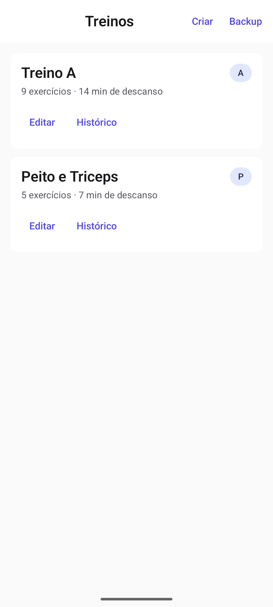
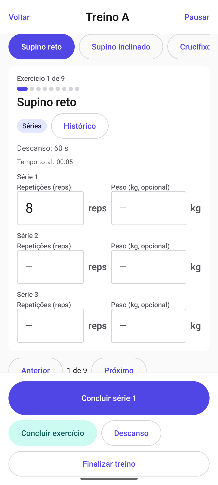
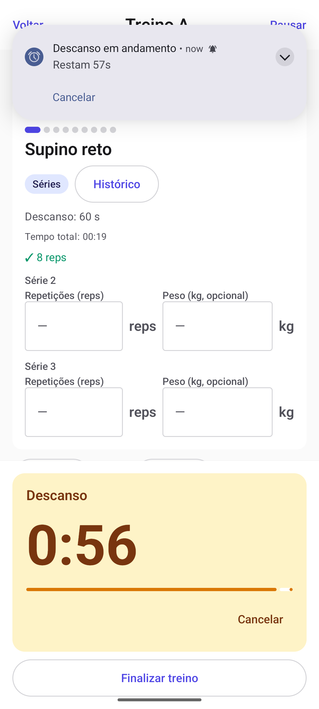
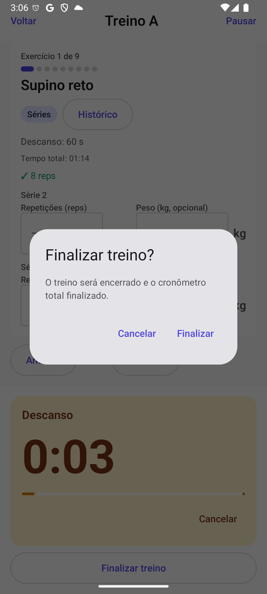
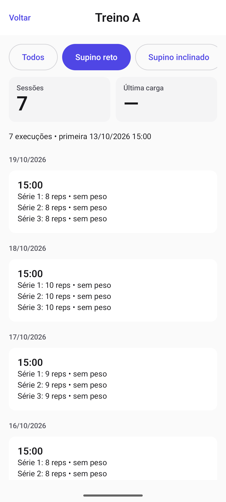
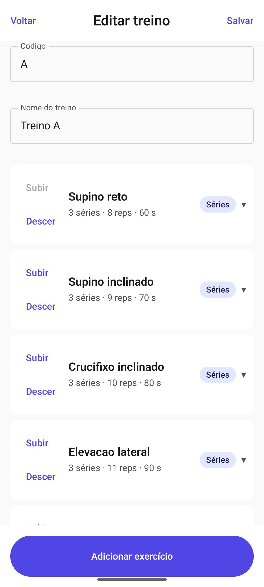
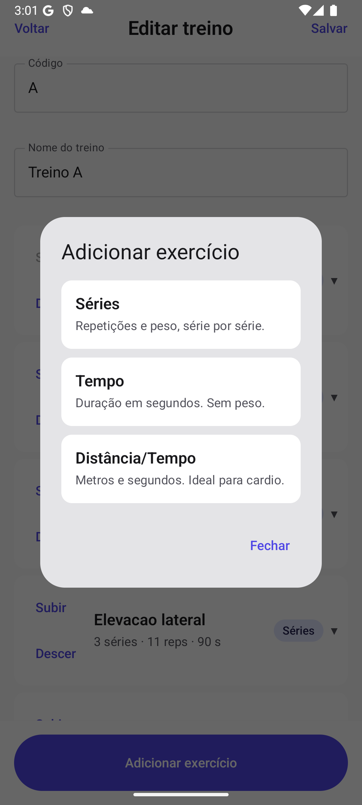
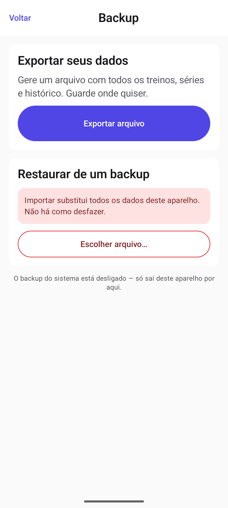
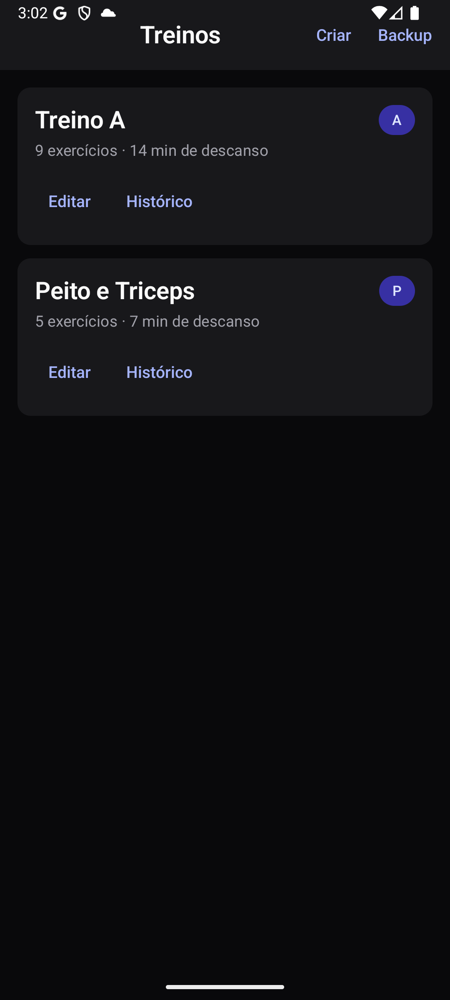

# Offline Workout

App de treino **offline** em Kotlin + Jetpack Compose. Sem conta, sem rede, sem nuvem.
Crie treinos, monte exercícios de três tipos, execute com cronômetro de descanso que
sobrevive à tela bloqueada, acompanhe evolução e faça backup local em JSON.

Módulo único, Clean-lite **sem `domain`**: `ui → viewmodel → data/repository → data/local`.
Namespace / base package / applicationId: `com.offlineworkout`. Room v1 com `exportSchema`,
sem `fallbackToDestructiveMigration`. **477 testes, 0 falhas.**

## O app

Cinco telas, uma para cada verbo:

| Tela | Rota | O que faz |
|---|---|---|
| Lista | `workouts` | Executa pelo card; `Editar`/`Histórico` por botão; `Criar`/`Backup` no topo |
| Editor | `workouts/new`, `workouts/{id}/edit` | Cadastra exercícios, move ordem, define descanso |
| Execução | `workouts/{id}/execute` | Séries, descanso, total da sessão — em modo performance |
| Histórico | `workouts/{id}/history?exerciseId=` | Gráfico de evolução em Canvas + tabela |
| Backup | `backup` | Exporta, compartilha, importa (substitui tudo) |

Três tipos de exercício: **Séries** (reps + kg), **Tempo** (segundos) e
**Distância/Tempo** (metros + segundos). O descanso roda em `ForegroundService` com
`specialUse`, sobrevive a tela bloqueada e morre de processo, e avisa por som e vibração
uma única vez.

## Telas

Capturas reais do app em execução, no tema claro (e uma no escuro).

<table>
<tr>
<td width="33%"><br><sub>Lista: o card abre a execução; Criar e Backup no topo</sub></td>
<td width="33%"><br><sub>Execução: séries, reps, kg e total da sessão</sub></td>
<td width="33%"><br><sub>Descanso com contagem regressiva</sub></td>
</tr>
<tr>
<td width="33%"><br><sub>Confirmação ao finalizar com descanso ativo</sub></td>
<td width="33%"><br><sub>Histórico por exercício, agrupado por dia</sub></td>
<td width="33%"><br><sub>Editor: ordem dos exercícios e descanso</sub></td>
</tr>
<tr>
<td width="33%"><br><sub>Os três tipos explicados no próprio app</sub></td>
<td width="33%"><br><sub>Backup: exportar e importar, com aviso destrutivo</sub></td>
<td width="33%"><br><sub>Lista no tema escuro</sub></td>
</tr>
</table>

## Build

```bash
./gradlew :app:assembleDebug
./gradlew :app:lintDebug
./gradlew :app:testDebugUnitTest
```

JDK 17, `compileSdk`/`targetSdk` 35, `minSdk` 26. Versões fixas em
`gradle/libs.versions.toml`.

### Release assinado

A keystore fica **fora do repositório**. Forneça os quatro valores:

```bash
./gradlew :app:assembleRelease   # exige os quatro valores; falha alto sem eles
```

Sem esses valores, `assembleDebug`/`lintDebug`/`testDebugUnitTest` funcionam normalmente e
**qualquer caminho que produza artefato de release falha com mensagem explícita**.

> Ativar R8 no futuro exige reexecutar a suíte inteira: `UiBoundaryTest` e
> `RepositoryBoundaryTest` resolvem classes por nome via reflexão, e minificar renomeia o
> que elas procuram.

## Decisões de produto

- **Código de treino é livre** — quantos treinos o usuário quiser. A/B/C é caso particular.
- **Auto Backup do sistema desligado** (`allowBackup="false"`): o único backup é o manual
  local (tela `backup`), por decisão explícita. Sem criptografia, sem nuvem.
- **Ordenação alfabética por `code`**, definida em um único lugar (o repositório).

## Pendências conhecidas

- **Sem ícone** — não há `mipmap`; a tela de detalhes usa o ícone genérico do sistema.
- **`targetSdk` 35** — a exigência vigente da loja é externa e datada.
- **Metade do gate de release** — a assinatura depende de credencial externa.
- **Não verificado em aparelho**: gráfico do histórico com dados, anúncio falado do
  cronômetro (o emulador não tem TTS) e `RestTimerService` com tela bloqueada.
- **Literais pré-existentes** em `MissingDestinationScreen`, `HistoryChart`, `LoadingBlock`
  e nos avisos dos ViewModels — migrá-los exigiria trocar contrato de UI/VM.

## Histórico de desenvolvimento

O projeto foi construído por um pipeline de agentes (arquitetura → desenvolvimento →
revisão visual em emulador → revisão de código), com specs e relatórios de revisão a cada
fase. **Esse histórico vive fora do repositório**, no Traycer do projeto — por isso as
referências a `artifacts/...` no restante deste README não são caminhos deste repo.

Os 20 commits do redesign de UI estão no histórico do git e são legíveis lote a lote.

## Estrutura

```text
android-app/
├── settings.gradle.kts
├── build.gradle.kts
├── gradle.properties
├── gradle/libs.versions.toml
├── gradlew / gradlew.bat
├── README.md
└── app/
    ├── build.gradle.kts
    ├── proguard-rules.pro
    └── src/
        ├── main/
        │   ├── AndroidManifest.xml
        │   ├── java/com/offlineworkout/
        │   │   ├── MainActivity.kt            # interfaces via Application; sem Room
        │   │   ├── OfflineWorkoutApplication.kt # composition root: possui o AppContainer process-scoped
        │   │   ├── ui/navigation/AppNavHost.kt# workouts + new + execute|edit + history?exerciseId (Long)
        │   │   ├── ui/workouts/WorkoutListRoute.kt + WorkoutListScreen.kt # cards Criar/Executar/Editar/Histórico
        │   │   ├── ui/history/WorkoutHistoryRoute.kt + WorkoutHistoryScreen.kt # seleção, resumo, gráfico, tabela (T7.1)
        │   │   ├── ui/history/HistoryChart.kt # Canvas Compose, eixos, 2 métricas, sem dependência (T7.1)
        │   │   ├── ui/execution/WorkoutExecutionRoute.kt # entrada: guarda ID, permissão, factory do VM (5 deps)
        │   │   ├── ui/execution/WorkoutExecutionScreen.kt # sessão+descanso+3 tipos, 48dp, live regions (T6.1)
        │   │   ├── ui/editor/WorkoutEditorRoute.kt      # editor real (factory interface+modo+config) + guarda de ID
        │   │   ├── ui/editor/WorkoutEditorScreen.kt     # form M3: campos por tipo, mover, salvar/cancelar, descarte
        │   │   ├── ui/backup/BackupRoute.kt + BackupScreen.kt # SAF (Create/OpenDocument) + estado/diálogo (T8.1)
        │   │   ├── ui/theme/Theme.kt          # tema Material 3 único
        │   │   ├── viewmodel/WorkoutListViewModel.kt # Loading/Empty/Success/Error + retry + efeitos OpenCreate/OpenExecution/OpenEdit
        │   │   ├── viewmodel/WorkoutEditorViewModel.kt# editor único Create/Edit: form, validação, save, descarte
        │   │   ├── viewmodel/WorkoutExecutionViewModel.kt # VM único: repos+timer+session, séries locais, 1 write (T6.1)
        │   │   ├── viewmodel/ExerciseHistoryViewModel.kt # VM único: seleção, página 50, stats/chart, retry (T7.1)
        │   │   ├── viewmodel/BackupViewModel.kt  # estados + efeitos; prévia obrigatória, 1 operação (T8.1)
        │   │   └── data/
        │   │       ├── AppContainer.kt          # owner de DB/repos/timer/session; expõe interfaces; Closeable idempotente
        │   │       ├── config/WorkoutEditorConfig.kt # defaultRestSeconds=0, allowEmptyWorkout=true (técnicos)
        │   │       ├── model/                   # contratos públicos, sem Room/SQL/Android (T2.1)
        │   │       │   ├── ExerciseType.kt      # enum único (converter em data/local importa daqui)
        │   │       │   ├── WorkoutSummary.kt / ExerciseSpec.kt
        │   │       │   ├── ExerciseExecutionView.kt (inclui ExecutionSetView)
        │   │       │   ├── ExerciseInputs.kt    # WorkoutDraft/Update, ExerciseInput, Series/Timed/DistanceTime + Set inputs
        │   │       │   ├── WorkoutAggregateDraft.kt # ExerciseAggregateDraft + WorkoutAggregateDraft (T4.1)
        │   │       │   ├── HistoryQuery.kt      # HistoryQuery/Stats + HISTORY_MAX_ROWS/PAGE_SIZE (T7.1)
        │   │       │   └── HistoryChart.kt      # HistoryPoint/ChartData, mapping, MinMaxDownsampler (T7.1)
        │   │       ├── backup/                  # formato e I/O do backup local (T8.1)
        │   │       │   ├── BackupJson.kt        # JsonValue + parser recursivo (profundidade limitada) + writer canônico
        │   │       │   ├── BackupCodec.kt       # envelope v1, SHA-256, UTF-8 estrito, erros de decode
        │   │       │   └── BackupFileGateway.kt + AndroidBackupFileGateway.kt # SAF + FileProvider
        │   │       ├── repository/              # interfaces + implementações Room (T2.1, agregados T4.1, history T7.1)
        │   │       │   ├── WorkoutRepository.kt # interface: CRUD, reorder, Flows + create/update agregados
        │   │       │   ├── ExerciseHistoryRepository.kt # T2.1 + T7.1: page/window/stats
        │   │       │   ├── RepositoryFailure.kt # Validation/NotFound/Conflict/Storage + RepositoryException
        │   │       │   ├── BackupRepository.kt  # contrato + BackupDocument/Preview/ImportResult/Failure (T8.1)
        │   │       │   └── RoomBackupRepository.kt # export ordenado + import replace-all transacional (T8.1)
        │   │       │   └── RoomWorkoutRepository.kt / RoomExerciseHistoryRepository.kt
        │   │       ├── timer/                   # descanso ForegroundService specialUse (T5.1)
        │   │       │   ├── RestTimerStatus/Snapshot/Request/CommandResult/Controller.kt # contratos puros
        │   │       │   ├── TimerClock.kt (System) + RestTimerStore.kt + SharedPrefsRestTimerStore.kt
        │   │       │   ├── RestAlertPlayer.kt (System: som padrão + vibração única)
        │   │       │   ├── RestTimerEngine.kt   # cérebro testável: tick/finish/restore/alert-once
        │   │       │   ├── AndroidRestTimerController.kt + RestTimerService.kt + BootCompletedReceiver.kt
        │   │       │   └── RestTimerNotifications.kt # canal rest_timer IMPORTANCE_HIGH
        │   │       └── session/                 # cronômetro total, sem FGS (T6.1)
        │   │           ├── WorkoutSessionStatus/State/Controller.kt # contratos + formatSessionElapsed
        │   │           ├── WorkoutSessionStore.kt + SharedPrefsWorkoutSessionStore.kt
        │   │           └── DefaultWorkoutSessionController.kt # tick 1s, pause/resume/stop, restore
        │   │       └── local/                   # schema Room v1 (T1.1): entidades, DAOs, relations, database
        │   │           ├── AppDatabase.kt       # @Database v1, 4 entidades, exportSchema=true
        │   │           ├── ExerciseTypeConverter.kt
        │   │           ├── WorkoutEntity.kt     # workouts(code UK)
        │   │           ├── ExerciseEntity.kt    # exercises(FK workout CASCADE, UNIQUE workout+position)
        │   │           ├── ExerciseExecutionEntity.kt # exercise_executions(FK exercise CASCADE)
        │   │           ├── ExecutionSetEntity.kt# execution_sets(FK execution CASCADE, UNIQUE execution+setNumber)
        │   │           ├── WorkoutWithExercises.kt / ExerciseWithExecutions.kt / ExerciseExecutionWithSets.kt
        │   │           └── WorkoutDao.kt / ExerciseDao.kt / ExerciseExecutionDao.kt
        │   ├── res/xml/file_paths.xml      # FileProvider: só cache-path "backups" (T8.1)
        │   └── res/values/ (strings, themes)
        └── test/java/com/offlineworkout/
            ├── SkeletonTest.kt
            ├── data/local/                  # testes Room JVM (Robolectric, DB em memória)
            │   ├── LocalDatabaseTest.kt     # harness: cria/fecha AppDatabase por teste
            │   ├── ExerciseTypeConverterTest.kt
            │   ├── WorkoutDaoTest.kt / ExerciseDaoTest.kt
            │   ├── ExerciseExecutionDaoTest.kt / CascadeTest.kt
            │   └── HistoryDaoTest.kt        # página/janela/stats (T7.1)
            ├── data/backup/                 # BackupCodecTest + AndroidBackupFileGatewayTest (T8.1)
            ├── data/model/                  # HistoryChartTest: mapping/downsample puros (T7.1)
            ├── data/repository/             # fronteira e implementações (T2.1, agregados T4.1)
            │   ├── MappingTest.kt           # regras reais de mapping entity→modelo
            │   ├── RepositoryBoundaryTest.kt# contratos/modelos sem Room/SQLite/data.local (reflexão)
            │   ├── RoomWorkoutRepositoryTest.kt / RoomExerciseHistoryRepositoryTest.kt
            │   ├── RoomWorkoutAggregateTest.kt  # agregados: create/edit/IDs/rollback/ordem (T4.1)
            │   ├── RoomBackupRepositoryTest.kt # export/ordem/prévia/substituição destrutiva/rejeições (T8.1/T8.3)
            │   └── HistoryQueryTest.kt      # página/janela/stats/normalização (T7.1)
            ├── data/AppContainerTest.kt     # + workoutEditorConfig(0, true) (T4.1) + timer/session (T5.1/T6.1)
            ├── data/session/                # WorkoutSessionControllerTest + WorkoutSessionStoreTest (T6.1)
            ├── data/timer/                  # engine/store/controller/service/receiver/canal/manifest (T5.1)
            ├── ui/backup/                   # BackupScreenTest: estados, prévia, diálogo (T8.1)
            ├── ui/editor/                   # WorkoutEditorScreenTest + WorkoutEditorDestinationTest (T4.1)
            ├── ui/execution/                # WorkoutExecutionScreenTest + WorkoutExecutionRouteTest (T5.1/T6.1)
            ├── ui/history/                  # WorkoutHistoryScreenTest + WorkoutHistoryDestinationTest (T7.1)
            ├── ui/navigation/               # RoutesTest (T3.1/T7.1)
            ├── ui/workouts/                 # WorkoutListScreenTest (T3.1/T4.1)
            ├── ui/UiBoundaryTest.kt         # fronteira ui/viewmodel (T2.1+)
            └── viewmodel/
                ├── WorkoutListViewModelTest.kt # fake de WorkoutRepository, sem Room (+ OpenCreate T4.1, + OpenHistory T7.1)
                ├── WorkoutEditorViewModelTest.kt # form/validação/save/descarte com fake (T4.1)
                ├── WorkoutExecutionViewModelTest.kt + WorkoutExecutionHistoryIntegrationTest.kt (T5.1/T6.1)
                ├── ExerciseHistoryViewModelTest.kt # seleção/página/retry/stats com fakes (T7.1)
                └── BackupViewModelTest.kt     # estados/efeitos/guards de operação única com fakes (T8.1)
```

Localização rápida: `MainActivity` em `app/src/main/java/com/offlineworkout/MainActivity.kt`,
`NavHost` em `ui/navigation/AppNavHost.kt`, lista em `ui/workouts/`,
`ViewModel` em `viewmodel/WorkoutListViewModel.kt`, container em `data/AppContainer.kt`,
persistência local em `data/local/AppDatabase.kt`.

## Versões efetivas (fixas, sem dinâmicas)

| Componente | Versão |
| --- | --- |
| Android Gradle Plugin | 8.7.3 |
| Kotlin | 2.0.21 |
| Gradle (wrapper) | 8.9 |
| KSP (`com.google.devtools.ksp`) | 2.0.21-1.0.25 |
| JDK | 17 |
| compileSdk / targetSdk | 35 |
| minSdk | 26 |
| Compose BOM | 2024.12.01 (Material 3 resolvido pelo BOM) |
| activity-compose | 1.10.0 |
| navigation-compose | 2.8.5 |
| room-runtime / room-ktx / room-compiler | 2.6.1 |
| lifecycle-viewmodel-compose / -ktx / runtime-compose | 2.8.7 |
| compose-ui-test-junit4 (BOM) / ui-test-manifest | teste / debug (atividade de teste no manifest debug) |
| kotlinx-coroutines-android | 1.9.0 |
| core-ktx / appcompat / junit | 1.15.0 / 1.7.0 / 4.13.2 |
| room-testing / androidx.test:core / robolectric | 2.6.1 / 1.6.1 / 4.13 (só `test`) |
| kotlinx-coroutines-test | 1.9.0 (só `test`) |

Fonte única de verdade: `gradle/libs.versions.toml`. Ajuste de baseline T0.1: adicionados
`core-ktx`, `appcompat` e `junit` (exigidos pelo template/AGP para o esqueleto compilar e
testar); KSP fixado em `2.0.21-1.0.25` para compatibilidade com Kotlin 2.0.21.

## Requisitos

- JDK 17
- Android SDK com `platforms;android-35` e `build-tools;35.0.0`
  (SDK do ambiente: `~/Library/Android/sdk`; exporte `ANDROID_HOME`/`ANDROID_SDK_ROOT`
  se ainda não estiverem definidos)

## Comandos (a partir de `android-app/`)

```bash
./gradlew :app:assembleDebug
./gradlew :app:lintDebug
./gradlew :app:testDebugUnitTest
```

### Build de release e assinatura (T9.2, D-3)

O build de release é **só assinatura**: `isMinifyEnabled = false` e sem
`isShrinkResources`. A keystore fica **fora do repositório** — não há segredo
em código e nada é commitado. Forneça os quatro valores como Gradle property
(`~/.gradle/gradle.properties`, fora deste repo, ou `-P`) ou como variável de
ambiente; a property tem precedência:

| Gradle property / env | Conteúdo |
|---|---|
| `OFFLINE_WORKOUT_KEYSTORE` | caminho absoluto do `.jks`/`.keystore` |
| `OFFLINE_WORKOUT_KEYSTORE_PASSWORD` | senha do store |
| `OFFLINE_WORKOUT_KEY_ALIAS` | alias da chave |
| `OFFLINE_WORKOUT_KEY_PASSWORD` | senha da chave |

```bash
./gradlew :app:assembleRelease          # exige os quatro valores
apksigner verify --print-certs app/build/outputs/apk/release/app-release.apk
```

Sem esses valores, `assembleDebug`/`lintDebug`/`testDebugUnitTest` funcionam
normalmente (o gate diário não depende de segredo) e **qualquer caminho que
produza um artefato de release falha com mensagem explícita** — inclusive
`:app:assemble` e `:app:build`, que não têm "release" no nome. A guarda tem duas
camadas: uma checagem de configuração (falha rápido, com a instrução) e um
`doFirst` em toda task que realmente escreve artefato de release (a autoritativa,
porque cobre `assemble`, `build`, `assembleAll`, IDE e qualquer alias).
Verificado na T9.3: `./gradlew :app:assemble` → **exit 1** com a mensagem de D-3;
`./gradlew :app:assembleDebug` → **exit 0**.

**R8 futuro exige reexecutar a suíte inteira:** `UiBoundaryTest` e
`RepositoryBoundaryTest` resolvem classes por nome via reflexão
(`Class.forName`), então minificação/shrink renomeia o que eles procuram. Ligar
`isMinifyEnabled`/`isShrinkResources` sem reexecutar tudo produz falso verde.

Verificação manual: instalar o APK debug em emulator/device API compatível, abrir a
Activity inicial e confirmar a UI Compose vazia sem crash; a partir da lista,
usar `Backup` para exportar (escolher destino no SAF), compartilhar o arquivo
gerado e reimportar pelo SAF confirmando a substituição. Sem segunda tela de
autenticação, rede ou sincronização.

## Integração contínua e releases

Dois workflows, com papéis separados.

| Workflow | Quando roda | O que faz |
|---|---|---|
| `.github/workflows/ci.yml` | todo push, todo PR e sob demanda | `assembleDebug`, `lintDebug`, `testDebugUnitTest` — exatamente o gate local |
| `.github/workflows/release.yml` | push em `main` e sob demanda | repete o gate, builda o APK de release, cria a tag e publica a release |

O CI roda o **mesmo** conjunto de tasks que o desenvolvedor roda localmente. Um
CI que valida menos que a máquina local é uma segunda opinião mais fraca, e o
verde dele não significa o que parece significar. O resumo do run publica a
contagem de testes, para que um verde com suíte encolhendo apareça na tela em
vez de passar despercebido.

### Versionamento (MAJOR.MINOR.PATCH)

O arquivo `VERSION` na raiz é a fonte da verdade para builds locais; a tag é a
fonte da verdade do que já foi publicado. O `versionCode` **não** é escrito à
mão: é derivado da versão semântica como `MAJOR * 10000 + MINOR * 100 + PATCH`,
o que o mantém monotônico (o Android recusa um `versionCode` menor) e impossível
de desalinhar do `versionName`.

- **PATCH** avança sozinho a cada merge em `main`. Não é preciso editar nada.
- **MAJOR/MINOR** mudam quando alguém edita `VERSION` no PR. A versão maior que
  a última tag vence, então `0.1.0` → `0.2.0` no `VERSION` produz a tag
  `v0.2.0` no merge seguinte, sem segundo passo manual.
- A versão é injetada no build por `-PversionName` / `-PversionCode`. O
  workflow não reescreve nem commita `VERSION` em `main`, então não há laço de
  gatilho e o histórico de tags é linear.

O APK é conferido com `aapt2 dump badging` **antes** de ser anexado à release:
um artefato publicado com `versionName` errado não tem como ser recolhido.

### Segredos de assinatura

O build de release falha de propósito sem keystore (ver *Build de release e
assinatura*). A release usa quatro segredos do repositório:

| Segredo | Conteúdo |
|---|---|
| `OFFLINE_WORKOUT_KEYSTORE_BASE64` | o `.jks` codificado em base64 |
| `OFFLINE_WORKOUT_KEYSTORE_PASSWORD` | senha do store |
| `OFFLINE_WORKOUT_KEY_ALIAS` | alias da chave |
| `OFFLINE_WORKOUT_KEY_PASSWORD` | senha da chave |

```bash
base64 -i release.jks | gh secret set OFFLINE_WORKOUT_KEYSTORE_BASE64
gh secret set OFFLINE_WORKOUT_KEYSTORE_PASSWORD
gh secret set OFFLINE_WORKOUT_KEY_ALIAS
gh secret set OFFLINE_WORKOUT_KEY_PASSWORD
```

A keystore é materializada em `$RUNNER_TEMP` e apagada ao fim do job, inclusive
em falha. Nenhum segredo entra no repositório e nenhum é impresso no log.

**Sem os quatro segredos**, a release publica `offline-workout-<versão>-debug.apk`:
o APK da variante debug, assinado com a chave de depuração do Android. Ele
instala normalmente e roda o mesmo código — apenas é *debuggable* e assinado por
uma chave descartável. Isso existe porque um APK **sem assinatura alguma não
instala**: o Android recusa com `has no signatures`. O guarda de D-3 não é
afrouxado por isso: o build continua incapaz de emitir um artefato de release
não assinado; o que muda é qual variante é construída. O corpo da release diz
explicitamente qual chave assinou o artefato.

## Decisões de arquitetura (resumo T0.1)

- Módulo único `app`; sem `domain`, sem DI, sem flavors.
- Compose + Material 3; `NavHost` com start `workouts` e destinos
  `workouts/{workoutId}/execute|edit` (rota `home`, `EmptyHomeScreen` e `HomeViewModel`
  removidos em T3.2).
- `WorkoutListViewModel` com `Loading`/`Empty`/`Success`/`Error`, via factory só com a interface.
- Room mínimo: placeholder documentado em `data/local` (sem `@Database`, pois o
  KSP do Room 2.6.1 rejeita zero entidades e T0.1 proíbe entidades fictícias);
  deps `room-runtime`/`room-ktx` declaradas e resolvidas; `@Database(version = 1,
  exportSchema = false)` entra com a primeira entidade real.
  → Superado em T1.2: `AppDatabase` v1 real com as 4 entidades (ver seção Schema T1.1).
- Sem cliques, timers, persistência real, rede ou navegação adicional.
- Sem `android:icon` no manifest (ícone/branding fora do escopo T0.1).

## Schema Room v1 (T1.1, implementado em T1.2)

Tabelas, unidades e ordenação — sem `domain`, sem tabelas por tipo:

| Tabela | Chave/constraints | Índices |
| --- | --- | --- |
| `workouts` (`id`, `code`, `name`, `createdAt` epoch-ms UTC) | PK `id`; `code` único | `index_workouts_code` (único) |
| `exercises` (`workoutId→workouts.id` CASCADE, `name`, `type`, `position` base 0, `restSeconds`, alvos nullable) | PK `id`; UNIQUE(`workoutId`,`position`) | `index_exercises_workout_position` (único), `exercises_workout_id` |
| `exercise_executions` (`exerciseId→exercises.id` CASCADE, `performedAt`/`completedAt` epoch-ms UTC, `durationSeconds`, `distanceMeters`) | PK `id` | `index_exercise_executions_history` (`exerciseId`, `performedAt DESC`, `id DESC`), `exercise_executions_exercise_id` |
| `execution_sets` (`executionId→exercise_executions.id` CASCADE, `setNumber` desde 1, `reps`, `weightKg` nullable) | PK `id`; UNIQUE(`executionId`,`setNumber`) | `index_execution_sets_execution_set` (único), `execution_sets_execution_id` |

- `ExerciseType` (`SERIES`/`TIMED`/`DISTANCE_TIME`) persistido como string estável via
  `ExerciseTypeConverter`; unidades fixas kg/reps/segundos/metros; colunas fora do tipo = `null`.
- Leituras: escritas `suspend`, observáveis `Flow`; histórico `performedAt DESC, id DESC`,
  séries `setNumber ASC` (garantido pelo DAO — `@Relation` não ordena).
- `exportSchema = true`, schema em `app/schemas/<Database>/1.json` (arg KSP
  `room.schemaLocation`); sem `fallbackToDestructiveMigration`; primeira mudança futura =
  `Migration(1, 2)` explícita. Instalação nova cria v1 (sem migration `0→1`).
- Validação de invariantes compostas e `WorkoutRepository` são T2.2 — DAOs prontos para consumo.

Bloqueios herdados de T1.1 (não implementados): `Tasks.md` da Fase 1 ausente; conteúdo/seeds
dos treinos (códigos livres, ver T9.2/D-1); segmentos temporais; semântica de peso/RPE.

## Contratos de repositório (T2.1, implementado em T2.2)

Fronteira: `viewmodel -> data/repository (interfaces) -> Room impls -> data/local (DAOs)`.
`ui`/`viewmodel` não importam `data.local`, Room ou DAOs (verificado por grep +
`RepositoryBoundaryTest`).

- Escritas `suspend` retornam `Result<T>` com `RepositoryFailure`
  (`Validation`/`NotFound`/`Conflict`/`Storage`); `SQLiteConstraintException` UNIQUE vira
  `Conflict`, demais constraints viram `Validation`, resto vira `Storage`;
  `CancellationException` é sempre relançada. Mensagens estáveis, sem SQL/paths.
- Leituras `Flow` convertem falha em `RepositoryException(failure)`; sem emissões parciais.
- `createWorkout` recebe `WorkoutDraft` e define `createdAt` via clock injetável
  (`() -> Long`, default `System.currentTimeMillis()`); `updateWorkout` preserva `id`/`createdAt`.
- `reorderExercises` valida pertinência exata e grava em 2 fases (posições temporárias
  negativas) dentro de `withTransaction` — UNIQUE(`workoutId`,`position`) nunca violado.
- Gravações de execução são atômicas (`withTransaction` parent+sets); validações de
  tipo/timestamps/séries consecutivas ocorrem antes do commit; `TIMED`/`DISTANCE_TIME`
  nunca criam sets.
- `observeLatestSet` deriva do DAO existente (`observeLatestForExercise` + último set da
  lista ordenada por `setNumber ASC`) — sem alteração estrutural nos DAOs.
- `HomeRepository` removido (sem consumidores; política preferida da spec T2.1).
- `RepositoryModels.kt` (listado na estrutura-alvo T2.1) não criado: failures vivem em
  `repository/RepositoryFailure.kt` e nenhum tipo adicional foi necessário.
- `Tasks.md` da Fase 2 ausente (bloqueio de fonte registrado); sem telas novas, sem
  `collectAsStateWithLifecycle` em uso, sem seeds/RPE/segmentos/`domain`.

## Lista, navegação e composition root (T3.1, implementado em T3.2)

- Composition root opção A: `OfflineWorkoutApplication` (manifest `android:name`) possui um
  `AppContainer` process-scoped em `data`; o container constrói/fecha `AppDatabase`,
  cria `RoomWorkoutRepository` e expõe só `workoutRepository: WorkoutRepository`
  (`Closeable` idempotente). Sem DI global/service locator; `MainActivity` recebe a
  interface e passa `AppNavHost(workoutRepository = ...)`; factory do ViewModel recebe
  só a interface. `ui`/`viewmodel` não importam Room, DAOs, `data.local`, `AppContainer`
  nem `RoomWorkoutRepository` (grep + `UiBoundaryTest`).
- Rotas: `workouts` (start, lista em ordem alfabética por `code`), `workouts/{workoutId}/execute`,
  `workouts/{workoutId}/edit` (argumento `Long` via `NavType.LongType`, só a partir do ID;
  rota `home` removida sem alias). Back retorna à lista.
- `WorkoutListViewModel`: `Loading`/`Empty`/`Success`/`Error` em `StateFlow`
  (`WhileSubscribed(5_000)`), retry por token com `flatMapLatest` (falha vira emissão
  `Error` sem matar a coleta — retry sempre recoleta), efeitos one-shot
  `OpenExecution`/`OpenEdit` via `Channel` validados contra a lista carregada.
- `WorkoutListScreen`: Scaffold + `LazyColumn` (`key = id`), cards com heading/nome/código,
  botões textuais `Executar`/`Editar` (48dp, `contentDescription` contextual), loading com
  indicador + descrição, empty sem ação de criação, error com `Tentar novamente`;
  live regions para loading/error; sem contadores/histórico/RPE/CRUD.
- Destinos `execute`/`edit`: seleção/loading mínimos, sem repository, sem escrita/timer/
  formulários; ID inválido (`<= 0`) mostra estado local com `Voltar para treinos`.
- Testes T3.2 (28): `AppContainerTest` (instância única, superfície só-interfaces, close
  idempotente, uso via container, ownership pela Application), `WorkoutListViewModelTest`
  reescrito (emissão fora de ordem repassada sem reordenar, Empty, Error estável, retry com
  recuperação, efeitos válidos/inválidos, nunca escreve), `RoutesTest`, `WorkoutListScreenTest`
  (4 estados, semântica, callbacks, sem ação Criar), `WorkoutDestinationsTest` (inválido com
  volta, válido em loading), `UiBoundaryTest` (6 classes sem tipos proibidos + assinatura
  do NavHost). Compose UI tests exigem runner Robolectric + `ui-test-manifest` no manifest debug.
- `Tasks.md` da Fase 3 ausente (bloqueio de fonte); conteúdo de execução/edição, textos
  finais, formulários, timers, histórico e RPE permanecem bloqueados.

## Editor de treinos (T4.1, implementado em T4.2)

- Configuração pura `data/config/WorkoutEditorConfig(defaultRestSeconds = 0,
  allowEmptyWorkout = true)`: `0` = sem descanso (válido por T1/T2, editável por
  exercício, sem conotação de produto); rascunho vazio permitido sem regra inventada.
  `AppContainer` expõe a config; `MainActivity` passa interface + config ao `AppNavHost`;
  factories recebem só o necessário.
- Rotas: `Criar treino` na lista emite `OpenCreate` → `workouts/new` (modo `Create`,
  sem ID); `workouts/{workoutId}/edit` abre o mesmo editor em modo `Edit`;
  `workouts/{id}/execute` inalterada. ID `<= 0` no edit não consulta repository.
- `WorkoutEditorViewModel` único: `Loading` (só Edit), `Ready`, `Saving`, `Error`,
  `NotFound`; form com textos (`String`), `clientId` estável (`existing-{id}`/`new-{n}`),
  `isDirty` por comparação com snapshot, `showDiscardConfirmation`; efeitos one-shot
  `Saved(id)`/`Closed`. `Saving` bloqueia saves/cancelamentos/edições concorrentes.
- Validação local por tipo (espelha o repository): código não vazio, nome, descanso int
  `>= 0`; SERIES exige sets/reps `> 0` e peso `>= 0` opcional; TIMED exige duração `> 0`;
  DISTANCE_TIME exige duração `> 0` e distância `>= 0`; troca de tipo limpa campos
  incompatíveis; `Conflict` mapeado para o campo de código.
- Agregados `createWorkoutWithExercises`/`updateWorkoutWithExercises`: validação total
  antes de qualquer write; `position` = índice da lista; edição exige cada ID existente
  exatamente uma vez (rejeita duplicado/desconhecido/estrangeiro/omissão sem apagar);
  tudo em um `withTransaction` com 2 fases de posições temporárias negativas; rollback
  total em qualquer falha; só `Result`/`RepositoryFailure` para a UI.
- Tela: topo com voltar, título `Novo treino`/`Editar treino`, campos com labels e
  unidades (`s`, `m`, `kg`, `reps`), seletor de 3 tipos, cards expansíveis com
  `Mover para cima/baixo` (disabled nos extremos, descrições contextuais) e
  `Editar/Recolher exercício`; barra `Salvar` (desabilitado em `Saving`)/
  `Cancelar`; diálogo `Descartar`/`Continuar editando`; `Tentar novamente` reexecuta a
  mesma operação (load ou save). Sem controle de remoção (bloqueado).
- Testes T4.2 (39): `RoomWorkoutAggregateTest` (9: vazio, 3 tipos, ordem, validação
  prévia, IDs, edição+reordenação, rejeições, rollback, NotFound),
  `WorkoutEditorViewModelTest` (15: Ready/Loading, carga ordenada, NotFound, retry de
  load, defaults por tipo, limpeza, validação, mover/extremos, dirty, descarte,
  agregado único, Saved once, Error com form, saves concorrentes, vazio ±config),
  `WorkoutEditorScreenTest` (11: estados, campos discriminados + unidades, mover
  disabled, erros inline, saving, retry, descarte, input), `WorkoutEditorDestinationTest`
  (3: inválido sem repo, edit carrega, create em branco), `RoutesTest` (+create),
  `WorkoutListScreenTest` (+Criar), `AppContainerTest` (+config),
  `RepositoryBoundaryTest` (+agregados), `UiBoundaryTest` (+editor/config/assinatura).
  Total **da fase**: 116 testes (contagem histórica; o total atual está no gate T9.3).
- `Tasks.md` da Fase 4 ausente (bloqueio de fonte); remoção de exercícios, segmentos,
  RPE, superséries, seeds e `domain` não implementados.

## Cronômetro de descanso (T5.1, implementado em T5.2)

- Escolha: `ForegroundService` `specialUse` (`workout_rest_timer`) — coroutine em
  ViewModel morre com a Activity/processo e não sustenta contagem com tela bloqueada.
  Sem `dataSync`/`location`/`mediaPlayback`/`health` mascarados; sem alarme exato.
- Owner do tempo é o `RestTimerService` (`data/timer`, `START_NOT_STICKY`,
  `exported=false`); ViewModel/Compose só enviam comandos e observam
  `StateFlow<RestTimerSnapshot?>` — nunca contam tempo, sem polling/broadcast por tick.
- Contratos puros: `RestTimerStatus` (Idle/Running/Finished), `RestTimerSnapshot`
  (deadline wall-clock; `remainingSeconds` derivado com teto, nunca negativo),
  `RestRequest`, `RestTimerCommandResult` (Started/Finished/Cancelled/Busy/Invalid),
  `RestTimerController` (`state`/`start`/`cancel`).
- Relógios: `elapsedRealtime` dentro do boot (imune a mudança de relógio);
  wall-clock persistido (`endsAtWallClockMs`) para restore/reboot. Contador nunca
  persistido; só transições (start/finish/cancel/alert) vão a disco (SharedPreferences,
  sem dependência nova).
- Restore em 3 níveis: recriação de Activity (mesmo controller), morte do processo
  (container reconcilia no start: vencido conclui+alerta, vivo reemite),
  reboot (`BootCompletedReceiver`: vencido conclui+alerta, vivo ganha notificação de
  status — nunca inicia FGS de background, nunca loop, nunca joga exceção).
- Alerta único: som padrão de notificação + vibração curta, via `RestAlertPlayer`
  (fake em testes); `alertDelivered` impede duplicata após restart; cancelamento é
  idempotente e não grava histórico (`ExerciseHistoryRepository` intocado).
- `restSeconds = 0` mostra `Sem descanso` e nunca inicia Service; um timer por vez
  (`Busy`); `onTaskRemoved` não cancela; sem pausa/fila/múltiplos/wearables/RPE.
- Permissões/manifest: `FOREGROUND_SERVICE`, `FOREGROUND_SERVICE_SPECIAL_USE`,
  `POST_NOTIFICATIONS` (request antes de iniciar; negada → FGS inicia, vibração direta
  tentada, áudio pode falhar), `VIBRATE`, `RECEIVE_BOOT_COMPLETED`. Canal `rest_timer`
  `IMPORTANCE_HIGH` com som padrão + vibração (config só na criação).
- `WorkoutExecutionViewModel(workoutId, repository, timer)`: combina
  `observeWorkout`/`observeExercises` com `timer.state`; avisos recuperáveis
  (`Busy`, `Invalid`, exercício ausente); `MainActivity` passa o controller do
  container; `ui`/`viewmodel` não importam Room/DAOs/`data.local`/Service/receiver
  (grep + `UiBoundaryTest`, com `Context` proibido só em ViewModels).
- Testes T5.2 (53): `RestTimerEngineTest` (10, JVM puro: validação, Busy, countdown
  monotônico, finish/alert-once, cancel idempotente, restore vivo/vencido/entregue),
  `RestTimerStoreTest` (6: round-trip, sem contador persistido, expiração, flags,
  cancel), `AndroidRestTimerControllerTest` (6: Invalid/Busy/intents/cancel/StateFlow),
  `RestTimerServiceTest` (3: foreground+contagem, inválido sem foreground, cancel
  limpa), `BootCompletedReceiverTest` (4: sem loop/serviço, vazio, vivo, vencido),
  `RestTimerNotificationsTest` (1: canal), `TimerManifestTest` (4: permissões, service,
  receiver, sem exact-alarm), `WorkoutExecutionViewModelTest` (8),
  `WorkoutExecutionScreenTest` (9), `WorkoutExecutionRouteTest` (2),
  `AppContainerTest` (+timer), `UiBoundaryTest` (+execução/controller). Total: 169.
- Limites OEM/bateria (verificação manual obrigatória): screen-off, background, morte
  de processo, reboot, cancelamento duplo, `POST_NOTIFICATIONS` negado, DND/silent,
  battery manager por fabricante, consumo 60s/5min; relógio manual/fusos não corrigidos;
  momento de início do descanso, som customizado, pausa, wearables fora de escopo.
- `Tasks.md` da Fase 5 ausente (bloqueio de fonte).

## Sessão de execução (T6.1, implementado em T6.2)

- `WorkoutExecutionViewModel` único `(workoutRepository, historyRepository,
  restTimer, session)`: estado imutável Loading/Ready/Error/NotFound; seleção e
  anterior/próximo; séries locais em strings (nada gravado por série); latest
  prefill via `observeLatestSet` (peso/reps) e `observeLatestExecution`
  (tempo/distância) com fallback para targets — nunca assume peso corporal;
  erro de latest é não bloqueante (`ExecutionError.Latest`).
- Uma única gravação atômica por exercício concluído (`recordSeriesExecution` com
  todas as séries, `recordTimedExecution`, `recordDistanceTimeExecution`);
  `savingExerciseId` bloqueia duplicatas; falha mantém o formulário com retry.
  `restSeconds = 0` nunca inicia descanso; `Busy`/`Invalid` viram aviso.
- Descanso T5.3 reutilizado após série/exercício (Idle/Running/Finished no estado);
  ViewModel não conta tempo. Finalizar cancela descanso Running (com confirmação
  na UI), para a sessão e emite `WorkoutFinished` uma vez — sem entidade nova.
- `WorkoutSessionController` + store separado (`workout_session` prefs): total com
  `TimerClock`, tick próprio de 1s (sem FGS/polling da UI), pause/resume/stop,
  restore por wall-clock; outra sessão ativa nunca é sobrescrita
  (`Sessão ativa em outro treino`); display `mm:ss`/`h:mm:ss`.
- Tela: top bar com nome/total/voltar, barra Pausar/Retomar/Finalizar treino, cards
  por tipo com labels+unidades, lista selecionável com Anterior/Próximo e
  indicadores textuais Concluído/Atual, banner de descanso, erros com retry,
  diálogo de confirmação ao finalizar com descanso ativo; 48dp, TalkBack, teclado,
  texto grande.
- Testes T6.2 (30): `WorkoutSessionControllerTest` (9: start/restore/pause/resume/
  stop/outro treino/tick sem persistir/formato), `WorkoutSessionStoreTest` (3),
  `WorkoutExecutionViewModelTest` (15: carga/seleção/prefill/séries/3 tipos/
  descanso zero/Busy/retry/concorrência/finish/sessão), integração Room+VM (1:
  prefill real + escrita atômica), `WorkoutExecutionScreenTest` (18: 3 tipos,
  pager, descanso, erros, finalizar, estados), `WorkoutExecutionRouteTest`
  (2: guarda sem calls, wiring), `AppContainerTest` (+history/session),
  `UiBoundaryTest` (fronteira estendida: impls de timer/session proibidos,
  assinatura do NavHost). Total: 199.
  Nota de infra: `advanceTimeBy` com múltiplo exato do período do tick vive em
  loop no kotlinx-coroutines-test 1.9.0 — os testes avançam 1500/2500/3500/5100ms;
  espera Room real usa poll com ambos os relógios (virtual+real).
- `Tasks.md` da Fase 6 ausente (bloqueio de fonte); sem RPE, séries obrigatórias,
  peso corporal, abandono, segmentos, sessão persistida ou `domain`.

## Correção T6.3 (review REPROVADO → corrigido, sem mudar a spec)

- **R-1 dono da sessão:** `onPauseSession`/`onResumeSession`/`onFinishWorkout` viram
  no-op com aviso (`Sessão ativa em outro treino`) quando a sessão Running/Paused
  pertence a outro treino; a UI desabilita Pausar/Retomar/Finalizar e rotula o total
  como `(outro treino)` nesse caso. Nenhuma mutação cruza treinos.
- **A-2 idempotência:** `onFinishWorkout` emite `WorkoutFinished` uma única vez
  (flag `finishedEmitted`).
- **A-3 close:** `AppContainer.close()` agora também fecha o session controller
  (ticker de 1s + escopo próprio).
- **A-4 semântica:** indicador `Concluído` com live region assertive; aviso
  `Latest` em estilo neutro/polite, separado do bloco de erro de gravação.
- **A-5 higiene:** removidos `println("DIAG…")`/`withTimeout` de depuração dos testes.
- **A-6 morto:** removidos `WorkoutExecutionEffect.Back` (nunca emitido), ramo
  `ExecutionError.Load` na tela e a duplicata `startRestFor`/`startRestTimer`
  (fusão com flag `clearNoticeOnStart`).
- **A-7 README:** árvore `local/` descolada e listagem de testes completada
  (`data/session`, `data/timer`, `ui/execution`, `ui/navigation`, `ui/workouts`,
  `WorkoutExecutionViewModelTest`, integração).
- **A-8 renumeração:** séries gravadas com `setNumber` denso (`mapIndexed`);
  teste cobre pular linha (concluir 1 e 3 grava 1 e 2).
- Testes da correção (4 novos, **total da fase** 203): VM sessão alheia/finish-once/denso +
  tela banner com ações desabilitadas. Gates com `--rerun` naquela fase:
  BUILD SUCCESSFUL, 203 testes, 0 falhas (contagem histórica; o total atual está
  no gate T9.3).
- A-9 (verificação manual em device) continua bloqueada.

## Histórico e gráfico (T7.1, implementado em T7.2)

- Rota única `workouts/{workoutId}/history?exerciseId={exerciseId}` (`exerciseId`
  opcional): `Histórico` no card da lista (efeito `OpenHistory`) e `Ver histórico`
  no exercício atual da execução; sem rota global. Ausente = seleção; `<= 0` =
  `Exercício inválido.` sem repository; ID de outro treino = não encontrado.
- Contrato estendido (T2.3 intacto): `HistoryQuery` (limit 1..500 normalizado,
  `offset < 0` = Validation, página 50), `observeHistoryPage` (DESC/id DESC),
  `observeHistoryWindow` (máx 500), `observeHistoryStats` (count/primeiro/último,
  sem PR/1RM/RPE). Room usa o índice `(exerciseId, performedAt, id)` existente.
- `ExerciseHistoryViewModel` único: Loading/Ready/Error/NotFound; seleção com
  reset + efeito `OpenHistory`; página acumulada sem duplicar (`hasMore`/
  `nextOffset` internos); retry preserva linhas; stats com aviso não bloqueante.
- Pontos por tipo (carga/reps, duração, distância+duração); séries sem peso fora
  da linha mas na tabela. Downsample min/max determinístico até 240 pontos
  (`wasDownsampled` + `totalPointCount` pré-redução para o texto "N de M").
- Canvas Compose sem dependência: eixos, escala com padding, 2 linhas para
  distância/tempo, legenda e `contentDescription` com tipo/unidade/contagem.
  Tabela textual e resumo (`N execuções`, datas, última métrica) sempre presentes;
  `Carregar mais` 48dp; TalkBack/texto grande/teclado.
- Somente leitura: nenhum write nesta fase. `Tasks.md` da Fase 7 ausente
  (bloqueio); sem PR/1RM/RPE/metas, retenção ou edição de histórico.

## Correção T7.3 (review REPROVADO → corrigido, sem mudar a spec)

- **R-1 seleção concorrente:** `select()`/`onClearExercise()` incrementam
  `selectionGeneration`; `loadPage`/`loadChartStats` capturam a geração e descartam
  resultados/erros obsoletos antes de qualquer escrita — tabela, gráfico, unidades
  e stats nunca descrevem outro exercício. Teste com dois selects e gates fora de
  ordem prova o descarte.
- **A-1/A-2 navegação:** removido braço `OpenHistory` duplicado (warning do
  compilador); navegar entre exercícios substitui a entrada (`popUpTo` inclusivo
  + `launchSingleTop`) em vez de empilhar um ViewModel por exercício.
- **A-3 gráfico:** datas curtas no eixo X, escala da métrica secundária na legenda
  e alturas flexíveis (`IntrinsicSize`, sem `Spacer` fixo).
- **A-4:** `visibleCount` renomeado para `totalPointCount` (total pré-redução).
- **A-5:** `Carregar mais` oculto com erro de página (retry único via banner).
- **A-6:** resumo deriva primeira/última/última métrica das linhas quando stats
  falha (sem inventar contagem).
- **A-7:** o botão `Histórico` da lista **não** tinha asserção antes desta
  correção; ela foi adicionada aqui (texto + clique + callback).
- Testes da correção (1 novo + ajustes, total 256). Gates com `--rerun-tasks`:
  BUILD SUCCESSFUL, 0 falhas. A-8 (manual em device) segue bloqueada.

## Backup local: exportação e importação (T8.1, implementado em T8.2, corrigido em T8.3)

- **Formato:** documento JSON UTF-8 canônico, `format = offline-workout-backup`,
  `schemaVersion = 1`, `exportedAtWallClockMs`, `appVersion`, `integrity`
  (SHA-256 sobre os bytes canônicos de `data`) e `data` com `workouts`,
  `exercises`, `executions`, `executionSets`. Escrita canônica sem espaços
  insignificantes e ordem determinística; a verificação tolera reformatação
  (espaços, quebras de linha, ordem de chaves) mas nunca alteração de valor.
- **Codec próprio** (`data/backup/BackupJson.kt` + `BackupCodec.kt`): parser JSON
  recursivo e writer canônico, UTF-8 estrito, `Corrupt` para JSON/estrutura
  inválida, `UnsupportedVersion` para `schemaVersion != 1` e `ChecksumMismatch`
  para payload adulterado. A recursão tem profundidade máxima
  (`MAX_JSON_DEPTH = 64`; o documento v1 usa 4 níveis), então um arquivo hostil
  de colchetes aninhados vira `Corrupt` em vez de `StackOverflowError`.
- **Limite técnico de tamanho (T8.3, não é valor de produto):**
  `MAX_BACKUP_BYTES = 4 MiB` é o maior documento que esta build lê ou escreve.
  A spec T8.1 deixa o tamanho máximo indefinido e exige medição antes de fixar
  o número. Medição feita no JVM com bytes da fonte, texto decodificado, árvore
  de parse completa e re-serialização canônica vivos ao mesmo tempo (heap após
  GC):

  | documento | memória retida | fator |
  |---|---|---|
  | 587 KB | 6,6 MB | 11,2x |
  | 1,68 MB | 18,6 MB | 11,1x |
  | 3,36 MB | 37,4 MB | 11,1x |
  | 4,70 MB | 37,9 MB | 8,1x |
  | 5,88 MB | 47,7 MB | 8,1x |

  Com 4 MiB o pico fica em ~46 MB de heap, folgado para o menor heap por app
  suportado (o dataset sintético de 240 exercícios / 9.600 execuções / 28.800
  séries, bem acima de um uso real, ocupa 3,4 MB — o limite é ~7x isso). Acima
  do limite: leitura falha com `BackupDocumentTooLargeException` (stream lido em
  blocos, nunca mais que `MAX_BACKUP_BYTES + 1`), exportação falha com
  `Storage` explícito e importação com `Corrupt` + "Escolher outro arquivo" —
  nunca OOM. `OutOfMemoryError`/`StackOverflowError` são capturados nas
  fronteiras e convertidos em falha.
- **`BackupRepository`:** `createDocument`, `preview`, `importReplaceAll`.
  `BackupFailure` (`Corrupt`, `UnsupportedVersion`, `ChecksumMismatch`,
  `Validation`, `ReferentiallyInvalid`, `Storage`) é `Throwable` e trafega em
  `Result`, como `RepositoryFailure`; `CancellationException` é relançada.
- **Importação atômica:** o arquivo é decodificado e **inteiramente validado**
  (identidades, código não vazio, posições únicas, referências, coerência
  SERIES/TIMED/DISTANCE_TIME, timestamps) **antes do primeiro DELETE**. Só então
  uma única transação executa a limpeza na ordem
  `executionSets -> executions -> exercises -> workouts` e reinsere na ordem
  inversa, preservando os IDs (sem remapear). Qualquer falha deixa o banco
  intacto.
- **Gateway SAF** (`BackupFileGateway` / `AndroidBackupFileGateway`):
  `ContentResolver` por `content://` (exportação via `CreateDocument`, importação
  via `OpenDocument`); nenhuma permissão de armazenamento e nenhum caminho
  absoluto. A importação lê o stream **em blocos com contagem**, limitado a
  `MAX_BACKUP_BYTES + 1` bytes: é streaming de verdade e nunca materializa um
  arquivo gigante. Compartilhamento gera o arquivo sanitizado em
  `cacheDir/backups` e o expõe por `FileProvider`
  (`${applicationId}.fileprovider`, `exported=false`, `grantUriPermissions=true`)
  com `ACTION_SEND` + `FLAG_GRANT_READ_URI_PERMISSION` (somente leitura).
  `res/xml/file_paths.xml` publica apenas `cache-path` `backups`.
- **Cache de compartilhamento com cleanup (T8.3):** no máximo **uma** cópia
  staged existe — cada novo compartilhamento apaga a anterior; depois do
  compartilhamento o ViewModel chama `purgeExpiredStagedCache()`, que remove o
  que passou do TTL técnico de 1 h e preserva o payload de um compartilhamento
  ainda em voo; e o `AppContainer` (raiz de composição do processo) faz
  `clearStagedCacheBlocking()` no startup, o que cobre qualquer limpeza que
  tenha falhado. Todas as três rotinas são idempotentes e nunca lançam: o cache
  nunca é fonte de verdade.
- **ViewModel/UI:** `BackupViewModel` expõe `Idle/Working/Preview/Success/Error` e
  efeitos `CreateDocument`/`Message`. Uma operação por vez, uri vazia = picker
  cancelado (volta a `Idle`, sem escrita), e a importação **sempre** mostra a
  prévia com o aviso `Isto substituirá todos os dados locais` antes do diálogo
  destrutivo `Confirmar substituição`. Nenhuma referência a
  Room/DAOs/`data.local` fora de `data`.
- **Compartilhamento é operação de verdade (T8.3):** o gateway faz o share
  dentro do ViewModel, então `Working(SHARE)`/`Success(SHARE)` existem e uma
  falha vira `Error` visível em vez de toque sem efeito.
- **Recuperação correta por tipo de erro (T8.3):** `Error` carrega
  `BackupRecovery`. Erro de arquivo (`Corrupt`, `UnsupportedVersion`,
  `ChecksumMismatch`, `Validation`, `ReferentiallyInvalid`) oferece
  **"Escolher outro arquivo"**, que rearma o `OpenDocument` (spec:263); erro de
  `Storage` oferece "Tentar novamente". Nenhum botão que não pode recuperar.
- **Ordem de exportação é contrato do arquivo (T8.3):** `workouts` por
  `code ASC, id ASC`; `exercises` por `workoutId ASC, position ASC, id ASC`;
  `executions` por `exerciseId ASC, performedAt DESC, id DESC`; `executionSets`
  por `executionId ASC, setNumber ASC, id ASC`. Quatro consultas dedicadas, sem
  agrupamento por ordem de iteração, e um teste com 3 treinos cujas ordens de
  `code` e `id` divergem falha se a ordem regredir.
- **Navegação:** ação textual `Backup` na lista de treinos → rota
  `Routes.BACKUP` (`backup`). Sem tela de Settings.
- **Fora de escopo (T8.1):** merge, remapeamento de IDs, agendamento, retenção,
  criptografia, nuvem, contas e compartilhamento automático.
- **Testes da fase:** `BackupCodecTest` (round-trip, determinismo,
  reformatação **e reordenação real das chaves do envelope**, adulteração,
  truncamento, UTF-8 quebrado, formato/versão/campos inválidos, número não
  finito, limite de tamanho, aninhamento até o limite e além), 
  `RoomBackupRepositoryTest` (ordem de exportação com 3 treinos, ordem estável,
  round-trip completo, preview, **substituição destrutiva a partir de um
  documento de outro banco**, rejeição com banco intacto para
  checksum/duplicatas/órfãs/posições/código/nome, documento grande demais, banco
  vazio, histórico preservado), `AndroidBackupFileGatewayTest` (streaming,
  leitura acima e abaixo do limite, destino ilegível, sanitização, uma única
  cópia staged, TTL, limpeza idempotente, cleanup de startup, `FileProvider` e
  flags do `ACTION_SEND`), `BackupViewModelTest` (estados, guarda de operação
  única, prévia obrigatória, cancelamento, share com sucesso e falha, retry de
  `Storage`, "escolher outro arquivo" em erro de arquivo, documento grande
  demais), `BackupScreenTest` (estados, contagens da prévia, diálogo destrutivo,
  cancelamentos sem escrita, ações de recuperação por tipo de erro, estados de
  share), `UiBoundaryTest` (tela/rota/ViewModel de backup), `AppContainerTest`
  (limpeza de cache no startup) e `WorkoutListScreenTest` +
  `WorkoutListViewModelTest` (botão `Backup` com alvo de 48dp e efeito
  `OpenBackup`).

## T9.3 — gate final e correções da review final

| Medida | Valor |
|---|---|
| Testes | **383**, 0 falhas, 0 erros, 0 ignorados (47 classes) |
| APK debug | **9,30 MB** |
| Tempo de export/preview/import (3.840 execuções, 1,32 MB) | **27 ms / 44 ms / 52 ms** (medianas) |
| Lint | 0 erros, 45 avisos (1 `DataExtractionRules` deliberado por D-2) |
| Warnings de compilador | 0 |

### Os 7 bloqueios da review final, corrigidos

1. **Editor sem rolagem.** `EditorForm` virou `LazyColumn` com
   `itemsIndexed(key = { it.clientId })` e `remember(exercise.clientId)` no card
   (a lista keyed que existia tinha sumido com a reconstrução). Teste
   `long_form_scrolls_and_save_stays_reachable`: com 8 exercícios, `Salvar` só
   existe depois de rolar, e o clique funciona.
2. **Guarda de assinatura inoperante.** `:app:assemble` passava e gerava release
   sem assinatura. Agora há checagem de configuração **e** `doFirst` em toda task
   que escreve artefato de release. Verificado: `:app:assemble` → exit 1 com a
   mensagem de D-3; `:app:assembleDebug` → exit 0.
3. **Retry de falha de leitura gravava no banco.** `ErrorBanner` roteava por
   `exerciseId != null`, e `ExecutionError.Latest` tem um — o clique chamava
   `onCompleteExercise`, uma escrita. `Latest` agora é texto polite **sem
   botão**; só `Save` reexecuta a escrita. Testes
   `latest_read_failure_has_no_write_retry` (nenhum botão, nenhuma escrita) e
   `save_failure_still_retries_the_write`.
4. **Avisos apagados no quadro em que aparecem.** O `onNoticeShown` era chamado
   no `LaunchedEffect` que exibia o aviso, então o nó nascia e morria no mesmo
   quadro. Agora o aviso permanece `NOTICE_VISIBLE_MS` (5 s, escolha técnica)
   antes de ser dispensado. Teste `notice_is_announced_and_survives_more_than_one_frame`
   com o relógio da composição controlado.
5. **"Concluído" perdeu o `liveRegion` assertivo** (correção aprovada na T6.3 A-4,
   reintroduzida na reconstrução). Restaurado e travado por
   `completed_marker_is_announced_assertively`.
6. **Sessão estrangeira.** As **três** ações de sessão recebem
   `enabled = !foreignSession`; `onFinishWorkout` cancela o descanso alheio
   **antes** de abortar; e a recusa volta a ter aviso — com frase diferente da do
   cabeçalho, preservando o ganho do R-10 (uma frase, um lugar). O teste antigo
   passava porque o clique abria o diálogo; agora há
   `foreign_session_disables_all_three_session_actions` e
   `foreign_paused_session_disables_resume` que afirmam o **estado do botão**,
   mais `finishing_with_a_foreign_session_cancels_its_rest_and_tells_the_user`.
7. **`NotFound` sempre acusava o exercício.** `ExerciseHistoryUiState.NotFound`
   passou a carregar o sujeito (`MissingRecord`); o ViewModel emite `WORKOUT`
   quando o treino não existe e `EXERCISE` quando o exercício não pertence a
   ele. Testes `notfound_says_workout_when_the_workout_is_gone` e
   `notfound_block_is_announced`.

### Testes que não provavam o que declaravam

- **R-12** — o teste só provava que `close()` era chamável. Melhorado:
  `isTickerActive` + asserção da transição.
- **R-15b** — o handoff pedia contar recomposições. Segue sendo um proxy de
  identidade (`assertSame` na lista e em cada entrada), que é o contrato que o
  Compose consome para pular a recomposição: esta versão do
  `ui-test-junit4` **não expõe** contador de recomposição, e contar exigiria um
  hook de instrumentação em produção. **A afirmação foi ajustada ao que o teste
  prova**; a medição real de recomposições é item de device (A-8).
- **R-16** — a medição imprimia tempos e não afirmava nada. Agora há um teto de
  30 s para a prévia do mesmo dataset (medida: 44 ms, margem ~680x), que volta a
  falhar alto se o `filter` quadrático voltar.

### Decisões de follow-up registradas

- **6 métodos de DAO usados só por teste permanecem em `main`**:
  `WorkoutDao.getByCode`, `ExerciseDao.countForWorkout`,
  `ExerciseDao.maxPositionForWorkout`, `ExerciseExecutionDao.getForExercise`,
  `.getLatestForExercise` e `.deleteByExercise`. Decisão: **ficam**, porque são a
  única cobertura das consultas do schema v1 nos testes de DAO
  (`phase-1/architecture`), e removê-los apagaria a verificação de contratos que
  a Fase 1 aprovou. Não são caminho de produção; se um dia deixarem de ter
  cobertura, saem.
- **R-15 injeta dois dispatchers** (IO para o banco, Default para CPU), não um
  como o handoff dizia: melhoria deliberada e justificada, não divergência.
- **Gates que exigem device continuam abertos**: A-8 (TalkBack com leitor real,
  fonte ampliada, restore, FGS, OEM) e a metade "assinado" do gate de release
  (`apksigner verify`), que precisa de credencial externa por decisão de D-3.
- **Bloqueios de produto mantidos**: B-1 (ícone/branding), B-5 (`targetSdk`),
  R-14 (dark mode), R-22 (fluxo pós-import), R-23 ("Iniciar descanso" sem
  exercício selecionado), R-24 (cold start).

## T9.2 — Lote 3: limpeza e risco residual (R-2, R-1, R-7, R-8, R-9, R-10, R-11, R-12, R-13, R-21, R-3)

- **R-2 — dependências mortas fora.** `androidx-appcompat` e
  `androidx-compose-ui-tooling-preview` não tinham **nenhum** import ou anotação
  no projeto (verificado por `grep` antes de remover). APK debug, medido nos dois
  lados com `--rerun-tasks`: **10,26 MB → 9,30 MB (−0,96 MB, −9,4%)**.
- **R-1 — três índices Room redundantes fora.** `exercises(workoutId)`,
  `exercise_executions(exerciseId)` e `execution_sets(executionId)` eram prefixo
  esquerdo de um índice composto que já existia. `EXPLAIN QUERY PLAN` foi
  impresso **antes e depois** (`RoomQueryPlanTest`, que também falha se alguma
  consulta cair em full scan): nos dois estados o planner escolhe o índice
  composto — `SEARCH ... USING INDEX index_exercises_workout_position`,
  `index_exercise_executions_history`, `index_execution_sets_execution_set`.
  O schema segue **v1**, sem `fallbackToDestructiveMigration` e sem
  `Migration(1,2)` (o app nunca foi publicado).
- **R-7 — linha morta removida.** A geração capturada em `select()` era um local
  não usado, porque `loadPage`/`loadChartStats` a rederivavam por padrão. Agora
  é passada explicitamente aos dois.
- **R-8 — `loadAll` com guarda de geração.** A carga inicial suspende duas vezes
  (treino, depois exercícios) e escrevia `NotFound`/`Ready`/`Error` sem conferir
  a geração. Agora há guarda nos quatro pontos de escrita, como `loadPage` e
  `loadChartStats`. Teste `stale_reload_does_not_overwrite_a_newer_selection`.
- **R-9 — `BackupEffect.Message` fora.** Nunca foi emitido; a tela de backup não
  tem estado de aviso transitório.
- **R-10 — frase duplicada fora.** "Sessão ativa em outro treino" vinha do
  cabeçalho **e** de um aviso do ViewModel, aparecendo duas vezes. A frase está
  agora em uma constante (`FOREIGN_SESSION_NOTICE`) e o ViewModel não a duplica.
  Testes: `foreign_session_banner_is_shown_exactly_once` (conta as ocorrências) e
  `foreign_session_actions_are_noops`.
- **R-11 — build sem `w:`.** Dois `@OptIn(ExperimentalCoroutinesApi::class)`
  explícitos (`flatMapLatest` é intencional aqui), o cast de `Map<Long, LocalExercise>`
  anotado no ponto exato com o motivo, o `instance is` sempre-verdadeiro do
  `AppContainerTest` trocado por atribuição tipada, e o `getParcelableExtra`
  depreciado anotado. **0 warnings** no build.
- **R-12 — `close()` para o ticker.** `WorkoutSessionController` agora é
  `Closeable`, então `AppContainer.close()` para o ticker de 1 Hz. **T9.3:** o
  teste original só provava que `close()` era chamável e passaria com o ticker
  vivo; o controller passou a expor `isTickerActive` e o teste agora afirma a
  transição (ligado → `close()` → desligado).
- **R-13 — densidade fixada.** O teste do botão `Backup` comparava pixels crus com
  um contrato em dp. A classe passa a `@Config(qualifiers = "xhdpi")` e converte
  via densidade antes de comparar com 48dp.
- **R-21 — código morto removido, com evidência.** Removidos: `ExecutionError.Load`
  (nunca construído), `BackupViewModel.onNoticeShown()` (corpo só comentário,
  nunca chamado), `ExerciseExecutionDao.update` (zero referências),
  `getLatestSetForExercise` e `WorkoutDao.insertAll` (só usados por teste; o
  `ExerciseDao.insertAll` **foi mantido** porque é usado em produção por
  `RoomWorkoutRepository:188`). Os testes que exercitavam os removidos foram
  reescritos para a via que a produção usa.
- **R-3 — ticker só quando `Running`.** O laço de 1 Hz rodava a vida inteira do
  processo; agora sai do laço fora de `Running` e `begin`/`resume` reentram.
  Teste `idle_does_not_tick` prova por tempo virtual que o elapsed não anda
  ocioso nem depois de `stop()`.
- **Residuais de teste.** `ExerciseHistoryViewModelTest` ganhou gates para
  `observeHistoryWindow`/`observeHistoryStats` (B-2) e um teste de carga x
  seleção concorrentes (R-8); `WorkoutHistoryScreenTest` ganhou rótulos de data no
  eixo X, faixa da métrica secundária, `Carregar mais` oculto em erro de página
  e resumo derivado das linhas sem `stats` (B-3) — este último exigiu restaurar
  a regra T7.3 A-5 no código, que a reconstrução do Lote 2 tinha perdido;
  `WorkoutExecutionScreenTest` ganhou a asserção de live region **polite** do
  aviso de "latest" (B-2 Fase 6), que obrigou a separar esse aviso do bloco
  assertivo.

## T9.2 — Lote 2: recomposição, densidade, acessibilidade e risco de serviço (R-15b, R-18, R-20, R-4, R-5)

- **R-15b — a lista de exercícios não é mais reconstruída a 1 Hz.** O motor de
  descanso grava o restante a cada segundo, e cada emissão do `combine` criava
  `ExecutionExerciseState` novos para todos os exercícios, então cada card
  visível — com seus `OutlinedTextField` — recomposia uma vez por segundo durante
  o descanso inteiro. Agora uma entrada é **reaproveitada** quando o `spec` e o
  input local por trás dela não mudaram, e a própria lista é reaproveitada
  quando todas as entradas foram; um tique do timer (ou mudança de seleção) não
  produz mais nenhuma entrada nova. Contrato de `WorkoutExecutionUiState.Ready`
  inalterado, sem `GlobalScope`, sem `derivedStateOf`, sem mutabilidade.
  Testes: `timer_ticks_keep_the_exercise_entries_identical` (dez tiques, mesma
  instância por `assertSame`, timer avançando de fato), `typed_input_still_produces_a_new_entry`
  (uma digitação **precisa** gerar entrada nova) e
  `selection_change_keeps_entries_and_moves_the_selection`.
- **R-18 — espessura do gráfico em dp.** Eixos (2), linhas de série (4) e raio
  dos pontos (6) eram pixels crus: 2 dp em mdpi e 0,67 dp em xxhdpi. Agora são
  constantes em dp (`AXIS_STROKE_DP`, `SERIES_STROKE_DP`, `POINT_RADIUS_DP`)
  convertidas no `drawScope`, e o `contentDescription` continua igual.
  `HistoryChartStrokeTest` prova a conversão em três densidades e que a linha de
  série continua o dobro do eixo em todas elas.
- **R-20 — destino inválido anunciado e texto unificado.** Havia cinco textos
  para duas condições e dois blocos de destino inválido **sem** `liveRegion`, ou
  seja, navegação silenciosa para o TalkBack. Agora existe um bloco único
  (`MissingDestinationScreen`) com duas condições (`INVALID` / `NOT_FOUND`),
  um texto por condição escrito em um único lugar, `liveRegion` assertive e uma
  única ação de 48 dp. Usado pela execução, pelo histórico e pelo editor.
  O único texto observável que mudou: o histórico passou de `Não encontrado.`
  para `Exercício não encontrado.`.
- **R-4 — o serviço não pode ficar vivo sem `startForeground`.** A guarda era
  "não existe snapshot", condição quase nunca verdadeira depois de
  `engine.restore()`; o serviço sobrevivia sem `startForeground` e o sistema
  respondia com `ForegroundServiceDidNotStartInTimeException`. Agora a condição é
  "o timer **não está** `Running`": nesse caso `stopForeground(STOP_FOREGROUND_REMOVE)`
  e `stopSelf()`. Preservados: alert-once, `onTaskRemoved` que não cancela,
  `START_NOT_STICKY` e os testes do engine. Três testes novos: extras inválidos
  param o serviço, snapshot `Finished` pré-existente também o para, e um timer
  realmente em andamento **não** é parado por um comando desconhecido.
- **R-5 — duplo toque não empilha mais destinos.** Os cinco `navigate` da lista
  passaram a usar a extensão `NavOptionsBuilder.listDestination()`, que aplica
  `launchSingleTop = true`. Virou função justamente para que nenhum call site
  possa esquecê-la e para que a opção seja testável sem `NavController`. O
  `popUpTo` do histórico introduzido na T7.3 continua intacto, então
  execução → histórico → voltar volta à origem. `RoutesTest` fixa a opção e o
  fato de dois efeitos consecutivos do mesmo alvo resolverem a mesma rota.

## T9.2 — Lote 1: desempenho do backup (R-15, R-16, R-17)

O `RoomBackupRepository` rodava **todo** o trabalho pesado no dispatcher de
chamada, que é `Main.immediate` quando quem chama é o `BackupViewModel`. As
quatro consultas de export, a validação completa, a escrita canônica e o
SHA-256 bloqueavam a main thread.

- **R-15 — dispatchers.** O repository injeta dois dispatchers, escolhidos
  pela natureza do trabalho: `ioDispatcher` (`Dispatchers.IO`) para o banco
  (as quatro consultas e a transação de escrita) e `cpuDispatcher`
  (`Dispatchers.Default`) para canonicalização, hash e validação, que são CPU
  puro sem bloqueio e não devem ocupar as threads do pool de IO. Ambos são
  injetáveis, o que permite provar por teste que o trabalho saiu da thread do
  chamador **sem** teste de tempo frágil (`ThreadRecordingDispatcher` grava em
  qual thread cada dispatch caiu). `CancellationException` continua relançada e
  a transação do Room roda dentro do contexto de IO.
- **R-16 — validação O(executions × sets).** `data.sets.filter { }` dentro do
  laço de execuções virou um `groupBy { it.executionId }` construído uma vez.
  A semântica é idêntica: mesma ordem de entrada (o arquivo já vem em
  `executionId ASC, setNumber ASC, id ASC`), mesma lista por execução feeding
  `validateSets` e mesmas mensagens. Três testes fixam que a validação por
  grupos continua rejeitando `setNumber` não consecutivo, séries em execução
  TIMED e série órfã.
- **R-17 — export serializava e hasheava duas vezes.** `encodeDocument`
  calculava os bytes canônicos e o hash e os devolvia só como `ByteArray`,
  obrigando o repository a chamar `encodeData` de novo para refazer a mesma
  serialização e o mesmo SHA-256. Agora `BackupCodec.encodeDocumentWithChecksum`
  devolve bytes **e** checksum numa passagem; `encodeDocument` continua existindo
  (mesmos bytes) e o valor do checksum não muda.

### Tempo medido de export/import (antes e depois)

Medido por `BackupPerformanceMeasurementTest`, que é reprodutível e **não tem
`sleep` nem asserção de tempo**: imprime milissegundos e só garante que o
dataset fica abaixo do limite técnico. Mediana de 5 execuções, mesma máquina,
mesmo dataset dos dois lados:

| Dataset | Documento | Export | Preview | Import |
|---|---|---|---|---|
| 8 treinos × 8 exercícios × 60 execuções × 3 séries (64 exercícios, 3.840 execuções, 11.520 séries) | 1.319.537 bytes (31% do limite) | **43 ms → 30–33 ms** (−25% a −30%) | **144 ms → 46–69 ms** (−52% a −68%) | **160 ms → 61–74 ms** (−54% a −62%) |

Faixa = mediana de 5 execuções em quatro rodadas do teste (o "antes" foi
medido no código anterior com o mesmo dataset e a mesma máquina; o número único
de antes é a mediana daquela rodada).

O documento exportado tem **exatamente os mesmos 1.319.537 bytes** antes e
depois: o formato v1 e o valor do checksum não mudaram. O ganho vem de R-16 (o
filtro quadrático dominava o preview/import) e R-17 (uma serialização e um
hash a menos no export); R-15 não muda o tempo de CPU, ele tira esse tempo da
main thread, o que é o ponto: export, prévia e importação deixam de congelar a
UI. Números em um device real ainda não medidos (A-8).

## T9.2 — Lote 0 do handoff (D-1, D-2, D-3, R-6)

Decisões de produto registradas no artefato de arquitetura da fase 9 (fora do repo —
ver "Histórico de desenvolvimento"). As três **removem** restrições que
nasceram da ausência do `Tasks.md`; nenhuma adiciona dependência, tabela, rota
ou tela, e nenhuma spec de produto das Fases 1–8 foi reescrita.

### D-1 — `workout.code` livre

A validação de domínio rejeitava qualquer código fora de `A`/`B`/`C`, o que
impedia um quarto treino. Hoje `code` é texto livre:

- `RoomWorkoutRepository.validateWorkoutFields` (fonte única) só recusa `code`
  **vazio** e `name` vazio. O índice único de `workouts.code` continua
  impedindo duplicidade, com `Conflict` já mapeado para o campo — é ele que
  segura a invariante agora que a lista de valores saiu.
- `RoomBackupRepository` reutiliza essa mesma função no import, então o
  import herda a regra de código livre sem reimplementá-la.
- `WorkoutEditorViewModel` só espelha a não-vaziez (`Informe o código`).
- `WorkoutEditorScreen` rotula o campo como `Código`, sem sugerir conjunto
  fechado.
- A/B/C continuam válidos como **fixture**: agora são apenas códigos livres
  entre outros.
- Testes: `blank_code_is_validation_failure` (o negativo virou vazio),
  `free_codes_are_accepted_including_a_fourth_workout` (quatro treinos + texto
  livre longo), `imports_free_code_beyond_abc` e
  `imports_free_codes_beyond_abc`, `rejects_blank_code_and_blank_name`.
  `duplicate_code_is_conflict` continua verde de propósito.

### R-6 — fonte única de ordenação

A ordenação da lista vive em **um** lugar, `RoomWorkoutRepository.observeWorkouts`,
por **ordem alfabética por `code`**. O `sortedByCode()` e o mapa `A/B/C` do
`WorkoutListViewModel` foram removidos como código morto, **sem substituto**:
o ViewModel repassa a lista como o repository entrega. Os testes
`nonempty_emission_is_passed_through_without_reordering` e
`viewmodel_does_not_sort_whatever_the_repository_delivers` fixam o pass-through
com códigos livres (nenhum mapa de precedência poderia fazê-los passar), e
`observe_workouts_is_ordered_alphabetically_by_code` fixa a ordem no repositório.

**Comportamento conhecido e aceito:** "alfabética" aqui é comparação de
`String` do Kotlin, isto é, por **unidade de código UTF-16** — sensível a
maiúsculas e a acentos. `"Costas"` vem antes de `"peito"` (`'C'`=67 < `'p'`=112)
e `"Remoção"` antes de `"Rezoo"` (`'m'`=109 < `'z'`=122). **Não** é ordem de
dicionário português; trocar por `Collator` com locale do dispositivo seria
dependência e decisão de produto que ninguém pediu. O teste
`ordering_compares_utf16_code_units_not_locale_dictionary` (e o equivalente no
`WorkoutListViewModelTest`) documenta o comportamento para que a diferença não
vire bug relatado como defeito.

### D-2 — Auto Backup do sistema desligado

`android:allowBackup="false"` no manifesto, **sem** `dataExtractionRules` (com
o backup desligado não há nada a excluir; a exclusão só faria sentido se ele
estivesse ligado). Ver "Bloqueios registrados da Fase 8" abaixo: o desligamento
é **deliberado**, não esquecimento.

**Consequência conhecida do lint:** `allowBackup` está depreciado a partir do
Android 12 e o lint emite um aviso `DataExtractionRules` (45 avisos, 0 erros)
sugerindo um `@xml` de regras. Mantemos o manifesto mínimo porque a decisão D-2
foi "sem `dataExtractionRules`", e a transferência device-to-device precisa ser
conferida no device (seção 6) antes de qualquer endurecimento.

### D-3 — só assinatura, sem R8

`signingConfigs.release` lendo a keystore de fora do repositório, ligada ao build
type release; `isMinifyEnabled = false` mantido e sem `isShrinkResources`.
Detalhes, variáveis e o aviso sobre R8 + testes por reflexão estão em
"Build de release e assinatura".

## Bloqueios registrados da Fase 8 (T8.1, spec:325)

Itens bloqueados por falta de decisão de produto — **não** implementados como
fato, e não cobertos por esta fase:

- **`Tasks.md` da Fase 8 não foi encontrado** (quebra o padrão registrado em
  todas as fases anteriores): sem ele não há textos finais, local padrão nem
  política de Settings.
- **Criptografia/password indefinidos.** O JSON é texto legível e o SHA-256 é
  integridade, não autenticidade. Escolher criptografia, chave ou passphrase é
  revisão separada de produto/segurança.
- **Local padrão de exportação, pasta Downloads, retenção, agendamento e
  limpeza automática** não definidos. SAF e cache são escolhas técnicas, não
  promessa de local. O único limite existente é o **limite técnico** de 4 MiB
  medido acima, que não é decisão de produto.
- **Tamanho máximo de backup** (comportamento com backup gigante) não é decisão
  de produto; o limite técnico aplicado e sua medição estão registrados acima.
- **FileProvider/Intent e SAF** são comuns, mas o comportamento de providers OEM,
  permissões e apps que revogam URI **exige verificação manual em device** —
  segue bloqueado (A-8), como o fallback de MIME para provider que reporta
  `application/octet-stream`.
- **Exportação de gráfico/imagem, CSV, nuvem, sincronização, agendamento e
  conta** estão fora da Fase 8.
- **Merge, remap, deduplicação e resolução de conflito** não definidos; a v1
  escolhe substituição total destrutiva.
- **Auto Backup do sistema: desligado por decisão (T9.2, D-2).** Com
  `allowBackup="false"` o Android não sobe `offline-workout.db` nem as
  SharedPreferences de sessão/descanso para a conta do usuário, e o app não
  restaura nada em outro device. Isso é **deliberado**, não esquecimento: a
  Fase 8 (backup manual, local, via SAF, com prévia e confirmação) é a
  **única** via de backup, coerente com "o app não recebe nem envia para nuvem
  implicitamente". O item de device da seção 6 deve confirmar que nenhum
  payload do app aparece no backup do sistema.
